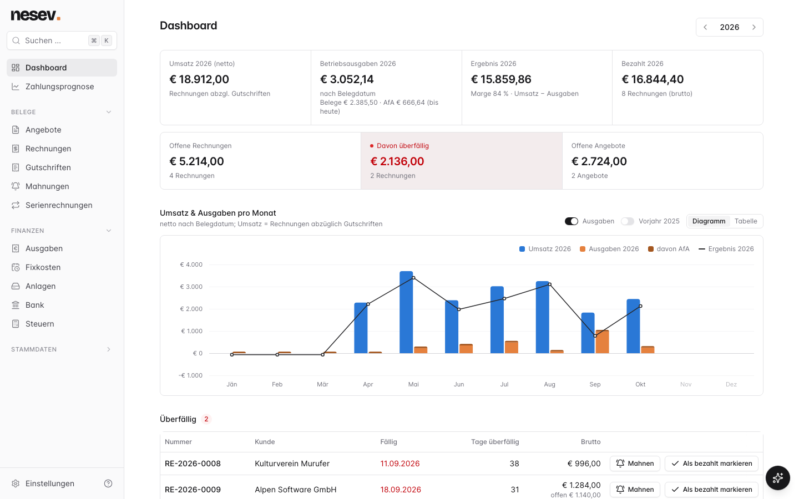
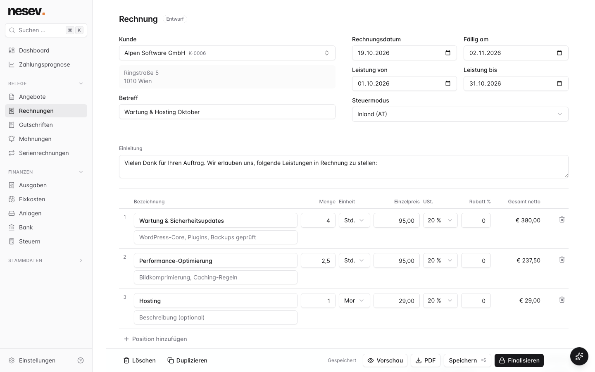
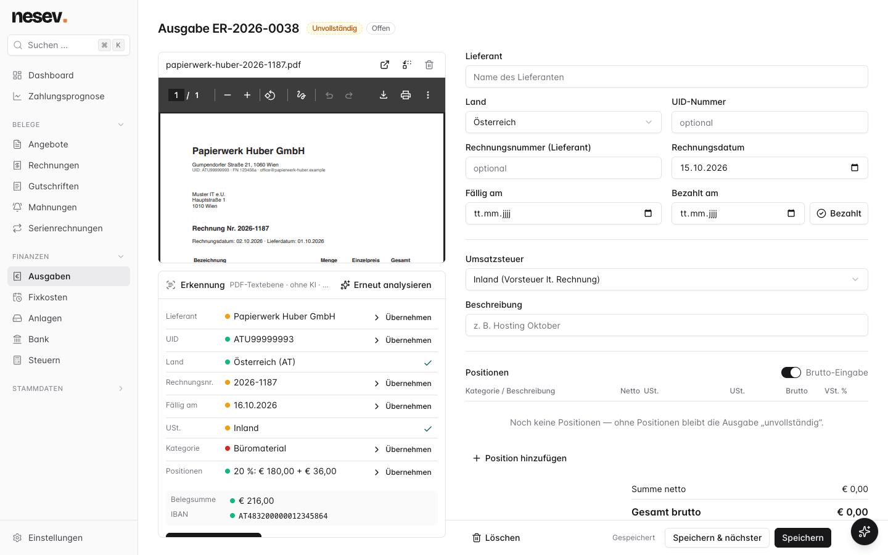
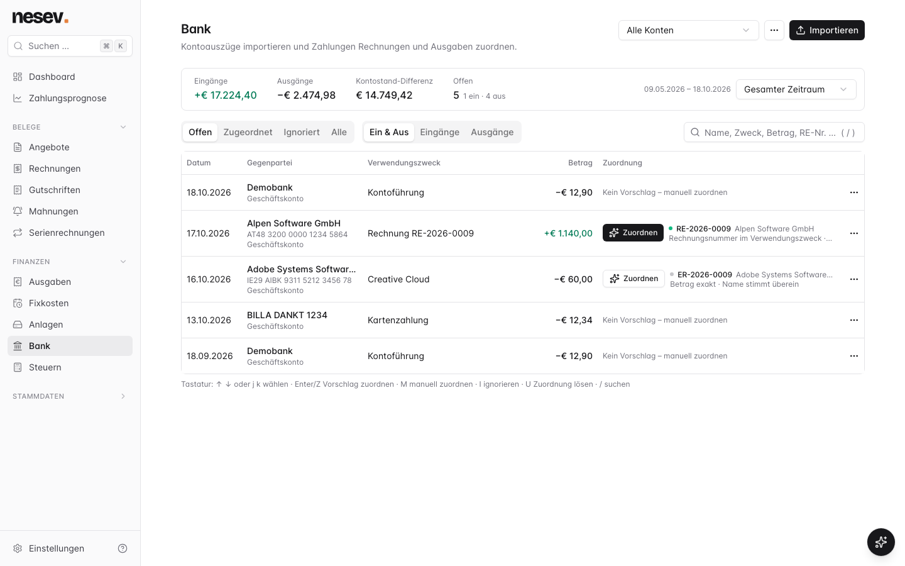
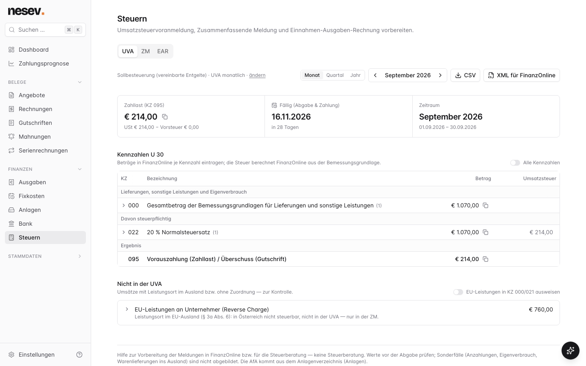
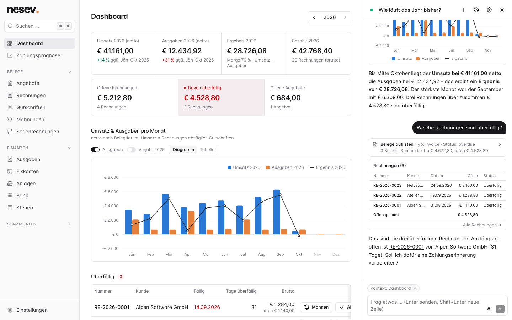
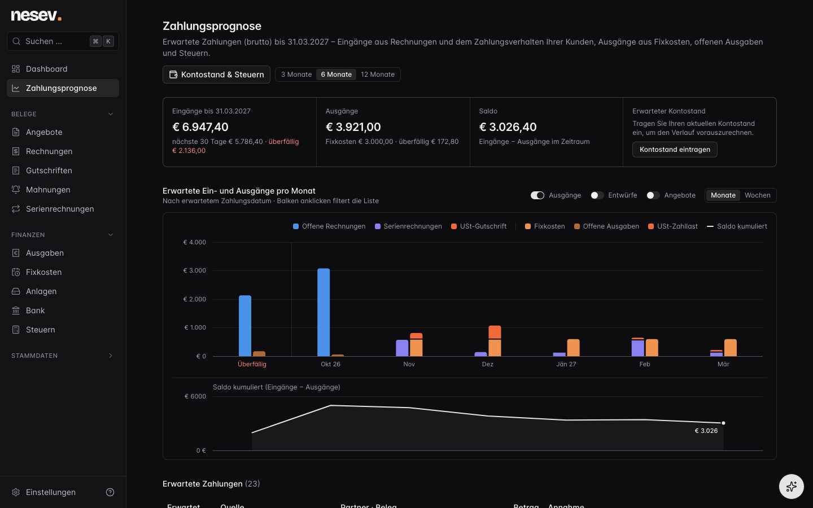
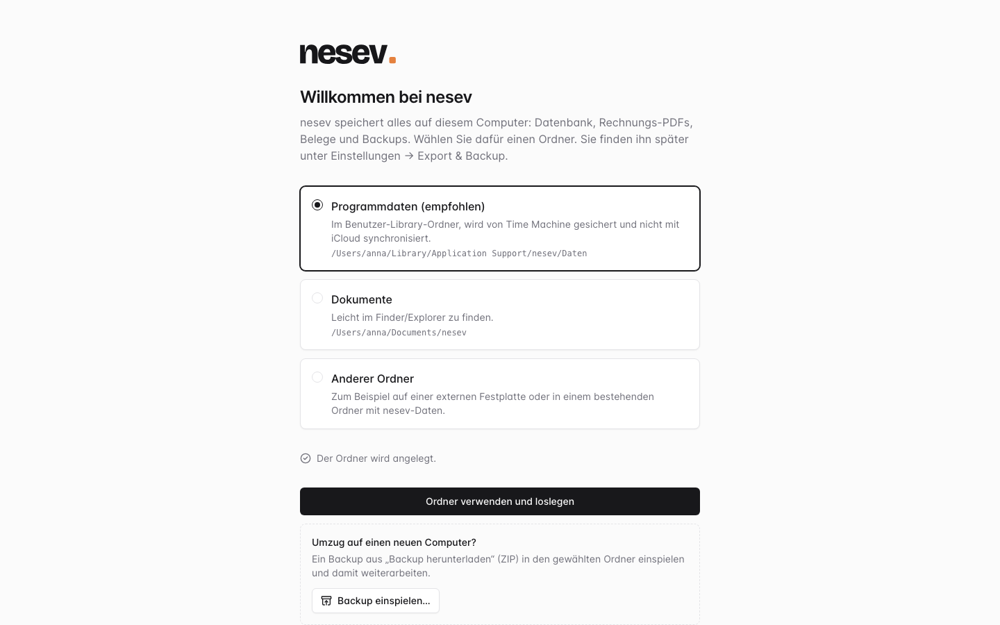

<p align="center">
  <picture>
    <source media="(prefers-color-scheme: dark)" srcset="docs/logo-dark.svg">
    
  </picture>
</p>

<p align="center">
  Local-first invoicing and bookkeeping for Austrian sole traders.
</p>

---

nesev is a lightweight, local alternative to hosted invoicing tools, built for a single Austrian sole trader
(Einzelunternehmer). You write offers, invoices and credit notes, record expenses, import bank statements and get UVA, ZM
and EAR figures. Everything runs on your own machine: no cloud, no account, no telemetry. All data stays in one folder
that you choose, and the optional AI features (receipt recognition, assistant, voice input) use local models only.

The user interface is **German**. The code, comments and docs are in English.

> [!NOTE]
> nesev is a bookkeeping **helper**, not tax advice. Check every figure before you file it, and talk to your
> Steuerberater when in doubt. See the [disclaimer](#disclaimer).

<p align="center">
  
</p>

## Features

**Belege: offers, invoices, credit notes, reminders**
- Gapless numbering (`RE-2026-0001`), finalized documents are immutable with frozen client and seller snapshots and a
  frozen PDF; corrections go through credit notes.
- Tax modes per document: domestic (20/13/10/0 %), EU reverse charge, third country, Kleinunternehmer.
- PDF template designer (pdfme) with letterhead support, article catalog, recurring invoices, dunning levels with fees
  and interest.
- **Zahlen mit Code**: EPC QR code (GiroCode) on invoices and reminders.
- **E-Rechnung**: ebInterface 6.1, XRechnung 3.0 (UBL) and ZUGFeRD / Factur-X (EN 16931, PDF/A-3b).

**Ausgaben & Belegerkennung**
- Expenses with receipts (PDF/JPG/PNG/WebP/HEIC), EAR categories, reverse charge / ig. Erwerb / import, partly
  deductible input VAT, fixed costs, fixed asset register with AfA.
- Belege-Eingang: watches a folder (e.g. a scanner folder) and collects new receipts.
- Receipt recognition **only on request**, fully local: embedded e-invoice XML, PDF text, Apple Vision OCR (Tesseract
  elsewhere) and a local llama.cpp model. Suggestions never overwrite saved data.
- Crop and straighten photographed receipts (macOS).

**Bank**
- Import camt.053/052/054 and CSV (N26, Revolut, Wise, plus a generic column mapper).
- Payment matching by invoice number, amount, learned IBAN and name; split and partial payments.

**Steuern: UVA, ZM, EAR**
- UVA with U30 Kennzahlen (Ist- or Sollbesteuerung, monthly or quarterly), ZM, Einnahmen-Ausgaben-Rechnung.
- Kleinunternehmer and Ist/Soll status with valid-from dates, Kleinunternehmergrenze tracking on the dashboard.
- Upload files for FinanzOnline (UVA U30, ZM U13), checked against the BMF XML schemas. nesev transmits nothing.
- Accountant export: BMD booking import CSV, generic CSV, receipts ZIP.

**Prognose**
- Cash forecast over 3–12 months: open invoices with each client's payment delay, recurring invoices, fixed costs,
  open expenses, VAT payments and income tax prepayments, with the projected account balance.

**Assistent**
- In-app chat assistant on a local model (llama.cpp, Qwen3.5-4B recommended) that can look things up, open records,
  draft invoices and match payments. Every state-changing action needs your confirmation.
- Voice input via whisper.cpp, also fully local.
- [MCP server](src/mcp/README.md) so external AI clients (Claude Code, Claude Desktop, …) can work with your data.

**Everything else**
- Global search (⌘K), keyboard shortcuts, dark mode, guided tour, CSV/ZIP export, backup ZIP and daily database
  snapshots.

## Screenshots

| | |
|---|---|
|  |  |
| Invoice editor | Expense with receipt recognition |
|  |  |
| Bank matching | UVA |
|  |  |
| Assistant | Dark mode |

All screenshots show demo data.

## Platforms

| | macOS | Linux | Windows |
|---|---|---|---|
| Core app (documents, expenses, bank, taxes, PDFs, e-invoices) | ✓ | ✓ | untested |
| Receipt OCR | Apple Vision | Tesseract, if installed | untested |
| Crop/straighten photo receipts, HEIC conversion | ✓ | – | – |
| Assistant (llama.cpp), voice input (whisper.cpp) | ✓ | ✓ | untested |
| Background service | launchd (`nesev service install`) | systemd user unit (`nesev service install`) | – |
| Release binary + one-line installer | ✓ (Apple silicon, Intel) | ✓ (x64, arm64) | – |

The core app is plain TypeScript and SQLite and is tested on macOS and Linux in CI. The macOS release binary ships
the Apple Vision helper precompiled; from source, OCR and receipt cropping need the Xcode command line tools
(`swiftc`) and the helper is compiled on first use.

## Requirements

- Nothing for the release binary. From source: [Bun](https://bun.sh) 1.3.13 or newer (no Node.js needed).
- Optional, for the assistant and receipt recognition: [llama.cpp](https://github.com/ggml-org/llama.cpp)
  (`llama-server`) and a GGUF model, e.g. run `llama-server -hf unsloth/Qwen3.5-4B-GGUF:UD-Q4_K_XL` once to download
  it. nesev starts and stops `llama-server` itself and never downloads anything.
- Optional, for voice input: [whisper.cpp](https://github.com/ggml-org/whisper.cpp) (`brew install whisper-cpp`) and a
  whisper model (`ggml-large-v3-turbo-q5_0` recommended).
- Optional, on Linux: [Tesseract](https://github.com/tesseract-ocr/tesseract) for receipt OCR.

## Try the demo

```bash
git clone https://github.com/nesevapp/nesev.git && cd nesev
bun install
bun run demo          # demo data in demo-data/, served on http://127.0.0.1:3999; your own data is not touched
```

`bun run demo -- --reset` seeds the demo data again (dates are relative to the seed day), `-- --port 4100` picks
another port.

## Installation

### One-line installer (macOS, Linux)

```bash
curl -fsSL https://raw.githubusercontent.com/nesevapp/nesev/main/install.sh | sh
```

The installer downloads the latest release for your computer (macOS on Apple silicon or Intel, Linux x64 or arm64) and
checks its SHA-256 checksum. It installs a single program to `~/.local/bin/nesev` (no admin rights needed) and sets up
a background service that starts nesev when you log in. Then it opens <http://localhost:3998>, where nesev asks where
to keep your data (see [Where your data lives](#where-your-data-lives)). Before writing the first invoice, fill in
Einstellungen → Unternehmen (company, UID, Steuernummer, IBAN): nesev doesn't finalize a document without your name
and full address, because finalized documents can't be changed.

You don't need Bun or Node.js. Everything is in that one file, including the Apple Vision helper for receipt OCR on
macOS. The optional extras (llama.cpp, whisper.cpp, Tesseract) are installed separately, see
[Requirements](#requirements). Settings for the installer: `NESEV_PORT` (default `3998`), `NESEV_INSTALL_DIR`
(default `~/.local/bin`), `NESEV_SKIP_SERVICE=1` (no background service).

### Manual download

Download `nesev-<os>-<arch>.tar.gz` and `SHA256SUMS` from
[Releases](https://github.com/nesevapp/nesev/releases/latest), then:

```bash
shasum -a 256 -c SHA256SUMS --ignore-missing    # Linux: sha256sum -c SHA256SUMS --ignore-missing
tar -xzf nesev-darwin-arm64.tar.gz
mkdir -p ~/.local/bin && mv nesev ~/.local/bin/
~/.local/bin/nesev                              # starts nesev and opens it in the browser
~/.local/bin/nesev service install              # optional: keep it running in the background
```

On macOS, a file downloaded in the browser is blocked by Gatekeeper, because the binaries aren't notarized yet. Allow
it with `xattr -d com.apple.quarantine ~/.local/bin/nesev`. The one-line installer doesn't need this step.

There are no Windows binaries yet. On Windows, run nesev from source (untested).

### The `nesev` command

| | |
|---|---|
| `nesev` | starts nesev and opens it in the browser (if it's already running, only opens the browser) |
| `nesev start` | starts only the server (that's what the background service runs) |
| `nesev service install` / `uninstall` / `status` | background service: launchd agent on macOS (logs in `~/Library/Logs/nesev/`), systemd user unit on Linux (`journalctl --user -u nesev`) |
| `nesev update` | installs the latest release (`--check` only looks) |
| `nesev restore <backup.zip>` | restores a backup ZIP or `.db`, also into a new folder on a new computer (`--data-dir`) |
| `nesev mcp` | the [MCP server](#mcp-server) (stdio) |
| `nesev uninstall` | removes the service and the program; your data stays |
| `nesev --version`, `nesev help` | |

`--port N` picks another port.

### Updating and uninstalling

Back up first (Einstellungen → Export & Backup). Then run `nesev update`, or run the one-line installer again. Either
way, nesev checks the download's checksum, replaces the program and restarts the background service. The database is
updated on the next start, after nesev has taken a snapshot of it.

`nesev uninstall` (or `curl -fsSL https://raw.githubusercontent.com/nesevapp/nesev/main/install.sh | sh -s -- --uninstall`)
removes the background service, the program and its cache. It never deletes your data, and it prints where the data
folder is. If you want everything gone, delete that folder yourself, after you've kept a backup.

### From source

For development, or on platforms without a release binary. Requires [Bun](https://bun.sh) 1.3.13 or newer.

```bash
git clone https://github.com/nesevapp/nesev.git && cd nesev
bun install
bun run build && bun start      # one process serves the web app and the API on http://localhost:3998
```

Open <http://localhost:3998>. On the first start nesev asks where to keep your data.

`bun run service:install` keeps nesev running in the background from the checkout (launchd on macOS, systemd user unit
on Linux; also `service:status`, `service:uninstall`). It uses the same service name as the binary, so installing one
replaces the other. To update, run `git pull && bun install && bun run build` and restart. `bun run build:binary`
builds the single-file executable. Cutting a release is described in [docs/releasing.md](docs/releasing.md).

> [!WARNING]
> nesev has **no authentication** by design. It listens on `127.0.0.1` only. Don't set `NESEV_HOST=0.0.0.0` or put it
> behind a public reverse proxy: anyone who can reach the port can read and change all of your bookkeeping data. See
> [SECURITY.md](SECURITY.md).

### Configuration

Nothing needs to be configured. The environment variables you are most likely to need:

| Env | Default | |
|---|---|---|
| `PORT` | `3998` | port of the server (web app + API) |
| `NESEV_DATA_DIR` | chosen on first start | overrides the data folder |
| `NESEV_HOST` | `127.0.0.1` | interface to listen on |
| `NESEV_ALLOWED_HOSTS` | – | extra hostnames (comma-separated) accepted in the `Host`/`Origin` header besides `localhost`, `127.0.0.1`, `[::1]` and a specific `NESEV_HOST` |

All variables, with explanations: [.env.example](.env.example).

## Where your data lives

<p align="center">
  
</p>

On the first start nesev asks for a data folder and suggests:


- the app-data folder of your system (**recommended**): macOS `~/Library/Application Support/nesev/Daten`, Linux
  `~/.local/share/nesev`, Windows `%LOCALAPPDATA%\nesev\Daten`;
- `~/Documents/nesev`, if you want to see the files in Finder/Explorer;
- any other folder (with a folder picker).

The choice is stored in a small config file (macOS `~/Library/Application Support/nesev/config.json`, Linux
`~/.config/nesev/config.json`, Windows `%APPDATA%\nesev\config.json`). To find the folder later, open Einstellungen →
Export & Backup, section „Datenordner“: it shows the path, where the setting comes from, and a button to open it in
Finder/Explorer. Choosing a folder that already holds a nesev database continues with that data. Moving to a new
computer: in the setup, pick a new folder and choose „Backup einspielen…“ with a backup ZIP from the old one (or
`nesev restore <backup.zip>`). Installs from before the setup existed keep using `<checkout>/data`.

To move your data, quit nesev, move the folder, and start nesev again: it notices that the folder is missing and asks
for the new location.

> [!CAUTION]
> Don't put the data folder inside a cloud-synced folder (iCloud Drive, OneDrive, Dropbox, Google Drive, also
> `~/Documents` when iCloud "Desktop & Documents" is on). Syncing a live SQLite database can corrupt it. nesev warns you
> in the setup. Back up the folder instead.

```
<data folder>/
  nesev.db      SQLite database (WAL mode)
  pdfs/         frozen PDFs of finalized documents
  receipts/     expense receipts by year
  assets/       logo, letterhead
  backups/      daily database snapshots (nesev-<date>.db, newest 14 kept), pre-migration-*.db (newest 5),
                before-restore-*/ (your data as it was before a restore; never deleted automatically)
  bin/          helpers compiled on first use (Apple Vision OCR)
```

### Backups

nesev keeps a daily snapshot of the database in `backups/` (database only, in the same folder, so it doesn't protect
against a lost disk). Under Einstellungen → Export & Backup you can download a backup ZIP (database snapshot, assets,
PDFs, receipts), CSV exports and an accountant export (BMD CSV, generic CSV, all documents and receipts as a ZIP).

Copy the backup ZIP, or the whole data folder while nesev is stopped, to another disk or an encrypted offsite
location regularly. Austrian law requires you to keep your records for seven years (§ 132 BAO).

**Restoring:** Einstellungen → Export & Backup → „Backup einspielen“ takes a backup ZIP (replaces the database,
assets, PDFs and receipts) or a single `.db` snapshot from `backups/` (replaces only the database). nesev shows what
the backup contains, and after you confirm it swaps it in on the next start; your current data is moved to
`backups/before-restore-<time>/` first. With the background service, „Jetzt neu starten“ does the restart; otherwise
quit and start nesev. Close MCP clients (Claude Desktop/Code) before that restart. A backup from a newer nesev
version is refused: update nesev first. On the command line: `nesev restore <backup.zip>`.

## Updating

1. **Back up first**: download a backup ZIP or copy the data folder.
2. Release binary: `nesev update` (or run the one-line installer again). From source: `git pull && bun install &&
   bun run build`, then restart (rerun `bun run service:install` if you use the background service).

Database migrations run automatically on start. Before it applies pending migrations, nesev writes a snapshot of the
database to `backups/pre-migration-<time>.db`; if that fails, nothing is migrated. A database written by a newer nesev
version is not opened. What changed is listed in the [changelog](CHANGELOG.md).

## MCP server

`nesev mcp` (from source: `bun run mcp`) starts a stdio [MCP](https://modelcontextprotocol.io) server with read and write tools (search,
dashboard, documents, expenses, tax reports, drafts, finalizing with confirmation in the client, …). It uses the same
data folder as the app, calls nesev's API in-process and opens no network port. Setup for Claude Code and Claude
Desktop: [src/mcp/README.md](src/mcp/README.md).

## Documentation

- [docs/architecture.md](docs/architecture.md): how each feature works, for contributors.
- [docs/assistant.md](docs/assistant.md): the assistant, voice input and the MCP server in detail.
- [docs/tax-notes.md](docs/tax-notes.md): simplifications and open tax questions.
- [docs/releasing.md](docs/releasing.md): cutting a release and how the single-file binary works.
- [ROADMAP.md](ROADMAP.md): what's next. [CHANGELOG.md](CHANGELOG.md): what changed.
- [CONTRIBUTING.md](CONTRIBUTING.md): setup, tests and the rules for changes. [CONVENTIONS.md](CONVENTIONS.md): code
  layout, API and form patterns. [CLAUDE.md](CLAUDE.md): invariants and gotchas (written for coding agents, useful for
  everyone).
- [Code of Conduct](CODE_OF_CONDUCT.md) · [Security policy](SECURITY.md)

Project layout:

```
src/shared/   logic shared by server and web: money, totals, tax modes, schemas
src/server/   Hono API (routes/, services/), SQLite + Drizzle, PDF, bank parsers, OCR, llama.cpp/whisper.cpp
src/web/      React SPA: features/<area>/, sdk/ (typed API client), shadcn/ui components
src/mcp/      MCP server
```

Questions: [GitHub Discussions](https://github.com/nesevapp/nesev/discussions). Bugs and feature requests:
[issues](https://github.com/nesevapp/nesev/issues). Security problems: report them privately, see
[SECURITY.md](SECURITY.md).

## Disclaimer

nesev is a bookkeeping **helper**, not tax advice. The UVA, ZM and EAR figures, the FinanzOnline upload files and the
BMD export follow Austrian rules as the author understands them and may be incomplete or wrong for your situation
(known simplifications: [docs/tax-notes.md](docs/tax-notes.md)). Check every figure before you file it, and talk to
your Steuerberater when in doubt. nesev transmits nothing to FinanzOnline; you upload the files yourself.

The software is provided "as is", without warranty of any kind (see sections 15 and 16 of the license). You are
responsible for your bookkeeping, for keeping records as required by law (e.g. BAO retention periods) and for backups.

## License

[GNU Affero General Public License v3.0 only](LICENSE) (AGPL-3.0-only).

You may use, change and share nesev freely. If you distribute it, or let other people use a modified version over a
network, you have to make the complete source code of your version available under the same license.

© 2026 Lukas Mascha – AGPL-3.0-only

## Credits

nesev is built on [Bun](https://bun.sh), [Hono](https://hono.dev), [SQLite](https://sqlite.org) and
[Drizzle ORM](https://orm.drizzle.team), [React](https://react.dev), [Vite](https://vite.dev),
[Tailwind CSS](https://tailwindcss.com), [shadcn/ui](https://ui.shadcn.com) and [Radix UI](https://www.radix-ui.com),
[TanStack Router, Query and Table](https://tanstack.com), [react-hook-form](https://react-hook-form.com),
[Zod](https://zod.dev), [pdfme](https://pdfme.com), [fflate](https://github.com/101arrowz/fflate),
[Lucide](https://lucide.dev) icons and the [MCP TypeScript SDK](https://github.com/modelcontextprotocol/typescript-sdk).
Local AI runs on [llama.cpp](https://github.com/ggml-org/llama.cpp) and [whisper.cpp](https://github.com/ggml-org/whisper.cpp).

The logo is set in [Bricolage Grotesque](https://github.com/ateliertriay/bricolage) (SIL Open Font License 1.1),
outlined to paths. PDFs use [Inter](https://rsms.me/inter/) (SIL Open Font License 1.1, bundled in
`src/server/assets/fonts/`).

### Third-party licenses

All production dependencies use permissive licenses compatible with the AGPL-3.0: MIT (most), Apache-2.0
(MCP SDK, Drizzle ORM, class-variance-authority), ISC (Lucide), BSD-3-Clause, 0BSD, Unlicense, MIT AND Zlib (pako) and
MPL-2.0 OR Apache-2.0 (DOMPurify, used under Apache-2.0). llama.cpp (MIT) and whisper.cpp (MIT) are external programs
that you install yourself; models have their own licenses.
